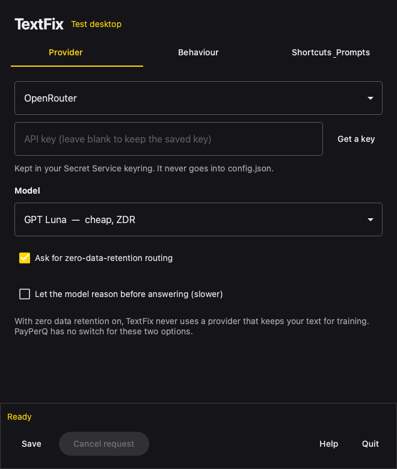

# TextFix for Linux



Native C++ / Qt Quick agent for Hyprland (including Omarchy) and X11. Other Wayland
desktops use clipboard mode. Qt 6.4 or newer is required; Qt is supplied by your
distribution rather than bundled in the download.

## Install a release

Download `TextFix-linux-x64.zip` or `TextFix-linux-arm64.zip`, extract it and run
`./install.sh`. This installs into `~/.local`; add `~/.local/bin` to PATH if needed.
The Omarchy archives include Hyprland binding examples as well. `./install.sh --uninstall`
removes the same files. It keeps `~/.config/textfix` and the key in your keyring.

The release binaries are built on Ubuntu 24.04. They need glibc 2.39 or later and Qt 6.4 or
later, which Ubuntu 24.04, Debian 13, Fedora 40 and Arch have. On an older distribution,
build from source.

On Ubuntu 24.04 or newer, install the runtime dependencies:

```sh
sudo apt install libqt6quickcontrols2-6 libqt6svg6 qt6-wayland \
  qml6-module-qtquick qml6-module-qtquick-controls qml6-module-qtquick-layouts \
  qml6-module-qtquick-window qml6-module-qtqml-workerscript \
  qml6-module-qtquick-templates libsecret-tools wl-clipboard xdotool x11-utils
```

On Arch / Omarchy, install `qt6-base qt6-declarative qt6-svg qt6-wayland
wl-clipboard libsecret`. Install `xdotool xorg-xprop` as well for X11.
A running Secret Service provider, such as GNOME Keyring or KeePassXC with Secret
Service integration enabled, is needed to save keys. `TEXTFIX_API_KEY` is also
accepted, including for headless use. Keys never go in config.json.

Run `textfix settings`, enter your provider key, pick a model, then save. Settings live
in `$XDG_CONFIG_HOME/textfix/config.json` (normally `~/.config/textfix/config.json`).
The provider, model, prompts and action settings use the Windows/macOS JSON names, and the
model list and the default prompts are the same on the three platforms. The clipboard,
startup and shortcut options are specific to Linux.

| Key | Default | What it does |
| --- | --- | --- |
| `indicator` | `notification` | `notification` shows one notification while a fix runs. `none` shows nothing. |
| `notifyOnError` | `true` | Show failures as a notification. |
| `restoreClipboard` | `true` | Put your clipboard back after the paste. |
| `clipboardRestoreDelayMs` | `300` | Raise it if an app pastes the old clipboard content. |
| `selectionProbeMs` | `400` | How long to wait for the first copy before TextFix selects the whole field. |
| `copyTimeoutMs` | `900` | Time for the whole-field copy. |

A `config.json` with an error does not stop TextFix: it uses the default settings and tells
you. The next save keeps the old file as `config.json.bad`.

## Desktop shortcuts

Bind `textfix fix` and `textfix rewrite` in your desktop shortcut settings. Commands
start the background agent on demand and forward subsequent requests to that one
process, which takes about 30 ms. A second invocation while busy cancels. One notification
shows while a fix runs and goes away when the text is in place; an error replaces it.
Closing Settings hides the window;
the tray icon opens it again. Middle-clicking the tray cancels; `textfix quit` exits.
The tray requires a StatusNotifier host; the commands work without one.

| Shortcut | Action |
| --- | --- |
| Ctrl+Alt+J (example desktop binding) | Fix |
| Ctrl+Alt+K (example desktop binding) | Rewrite |
| Ctrl+S in Settings | Save |
| Escape in Settings | Hide |
| ? outside text inputs | Shortcut help |
| Q outside text inputs | Quit with confirmation |
| Ctrl+Z in the target app | Undo replacement |

For Omarchy, build and install a native Arch package from the repository root:

```sh
cd packaging/omarchy
makepkg -si
```

Or install an extracted `TextFix-omarchy-<arch>.zip` using its `install.sh`.
The app follows Omarchy's accent, background, foreground, window rounding and
language file live. English and Italian are bundled; other languages fall back
to English. Theme watching uses file notifications, with no idle polling.

Add the bindings explicitly after checking for existing conflicts:

```lua
-- ~/.config/hypr/bindings.lua, for a package installed into /usr:
dofile("/usr/share/textfix/omarchy/textfix.lua")
-- For a user installation, use ~/.local/share instead:
-- dofile(os.getenv("HOME") .. "/.local/share/textfix/omarchy/textfix.lua")
```

For older Hyprland configurations, source the adjacent `textfix.conf` instead.
The examples run on key press. TextFix sends its copy and paste through Hyprland with the
modifiers given explicitly, so the keys that you still hold do not change them.
Change the example chords to F13/F14 for a VIA/QMK keyboard. Installation does not
edit Hyprland files or claim keybindings automatically. The optional **Start TextFix
when I log in** setting uses the standard XDG autostart directory; on desktops
without XDG autostart, add `textfix --background` to the compositor's autostart.

## Desktop behavior and limits

Hyprland uses `hyprctl`'s native shortcut dispatcher (Lua and older configurations
are supported) and `wl-clipboard`; X11 uses `xdotool` and Qt's clipboard. No root
keyboard daemon or `/dev/uinput` access is needed. Keep TextFix in the same desktop
session as the target app.

With a selection, only that text is replaced. Otherwise Ctrl+A/C copies the whole
field when enabled. If nothing is pasted after that (an error, or no change), TextFix
sends the Right arrow so that the field does not stay fully selected.

**Terminal windows are refused**, as on Windows and macOS. A paste into a shell, or into
an editor in command mode, can run what the model wrote. TextFix knows the common
terminals by their window class, and on Omarchy each window with the `terminal` tag. It
does not see a terminal inside an editor or a browser. For terminal text, copy it and run
`textfix clipboard`.

Only trigger in a trusted editable field: Linux does not provide a reliable
cross-application password-field check.

The window identity is checked before each synthetic shortcut and before pasting.
Switching windows cancels replacement and keeps your clipboard safe. Moving the
caret or changing the selection inside the same window cannot be detected, so
leave the target untouched until the request finishes.

X11 restores all offered clipboard formats. Wayland restores **one representation**
(UTF-8/plain text preferred, then PNG, then the first offered type); rich text's
alternate formats are not retained. A clipboard with no readable offer may require
copying text once before direct replacement. Clipboard changes during a request or
the restore delay are respected. `wl-copy --sensitive` is used when available,
but clipboard managers can still record the target app's own Ctrl+C operation.

On GNOME Wayland, KDE Wayland and other compositors:

```sh
textfix clipboard             # copy first, run this, then paste yourself
textfix clipboard --rewrite
```

This mode never injects keys, leaves the result on the clipboard and refuses to
overwrite a clipboard that changed during the request. Desktop action commands
exit after submitting work; the agent reports completion/errors through desktop
notifications and Settings. Use `filter` for synchronous scripts and exit status.

The provider policy is the same as on Windows and macOS. With zero data retention on,
each OpenRouter request asks for a ZDR route. If the model has none, TextFix sends the
request one time more, only to providers that do not keep prompts for training, and tells
you one time for each model. If no provider meets that rule, the fix fails. Requests have
a total deadline, three attempts with backoff, bounded replies, no cookies and no
redirects. TextFix keeps no log, and it never shows or stores a provider error body.

## Build and test

Needs a C++17 compiler, make, qmake6, Qt 6 base/declarative/SVG development packages,
and zip. On Ubuntu add `qt6-base-dev qt6-declarative-dev qt6-svg-dev`; Arch includes
the development files in its Qt packages. No third-party source downloads are used.

```sh
./build-linux.sh --test --zip --version 1.5.0
./build-linux.sh --omarchy --zip --version 1.5.0
textfix doctor --json
printf 'rough text' | textfix filter
printf 'rough text' | textfix filter --rewrite --json
```

Filter and doctor run without a display. Filter exits 0 on success and 1 on errors;
`--json` returns `ok`, `text` and `error`. Doctor reports tools and direct-replacement
availability, with exit 1 when the desktop requires setup or clipboard mode.
Enable **Dry run** to test capture/replacement locally using uppercase text without
spending API credits. CI builds/tests x64 and arm64 on Ubuntu and builds an Omarchy
package on Arch. Tagged releases include Linux and Omarchy zip files, Arch packages,
checksums and GitHub build attestations.
